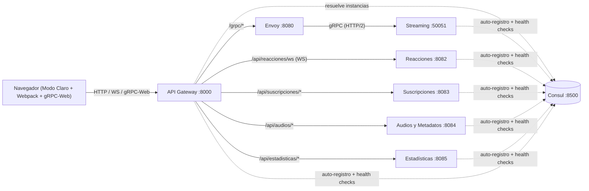

# Transmisión de Audio con gRPC-Web — Sistema Distribuido

Laboratorio completo de microservicios en **Go** con descubrimiento en **Consul**, **API Gateway** como punto de entrada único, **Envoy** como proxy **gRPC-Web → gRPC**, WebSockets en tiempo real y cliente web en **modo claro** compilado con **Webpack**.

## Arquitectura



| Servicio | Puerto interno | Puerto host | Responsabilidad |
|---|---|---|---|
| **Frontend** | 80 | **3000** | UI en modo claro compilada con Webpack (`frontend/Dockerfile`) |
| **API Gateway** | 8000 | **8000** | Punto de entrada único, CORS centralizado y balanceo round-robin vía Consul |
| **Consul** | 8500 | **8500** | Descubrimiento y health checks de servicios |
| **Envoy** | 8080 / 9901 | **8080 / 9901** | Traducción gRPC-Web (HTTP/1.1) → gRPC nativo (HTTP/2) |
| **Streaming** | 50051 (gRPC) / 8081 | — | `AudioStreamer.StreamAudio`: streaming de audio en chunks de `64 KB` |
| **Reacciones** | 8082 | — | WebSocket `/ws` por sala `audio_id` (broadcast `play`/`pause` a otros clientes) |
| **Suscripciones** | 8083 | — | Pagos simulados (`/pagar`) y tokens UUID de un solo uso (`/validar-token`) |
| **Audios** | 8084 | — | Catálogo desde `seed.json` (`/lista?tipo=...`) y registro/subida (`/registrar`) |
| **Estadísticas** | 8085 | — | Contador de reproducciones (`/reproducir`) e historial (`/historial`) |

## Ejecución (100% Dockerizado)

```powershell
docker-compose up -d --build
docker-compose ps
```

Accesos desde el navegador:
- **Aplicación Web (Modo Claro):** http://localhost:3000
- **Consul UI:** http://localhost:8500
- **API Gateway:** http://localhost:8000/gateway/services
- **Envoy Admin:** http://localhost:9901/ready

## Compilación manual del Frontend (Webpack)

```powershell
cd frontend
npm install
npx webpack --mode production
```

## Pruebas

```powershell
# Pruebas unitarias Go (suscripciones, audios, estadisticas, reacciones)
go test -v ./...

# Prueba de integración gRPC-Web (vía API Gateway -> Envoy -> Streaming)
node scripts/test-grpcweb-stream.mjs --url http://localhost:8000/grpc/audio.AudioStreamer/StreamAudio --titulo "cancion1" --formato "mp3"
```
